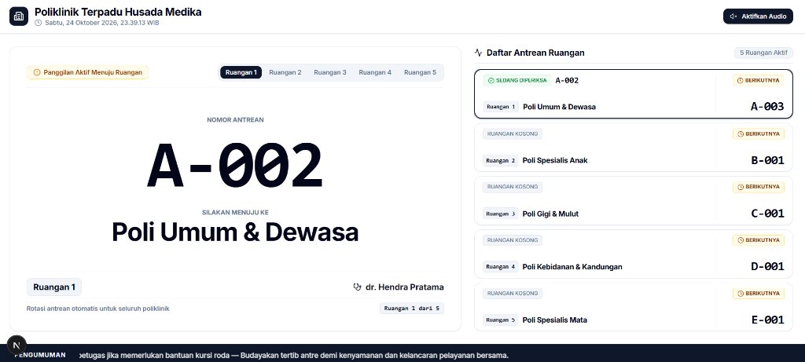
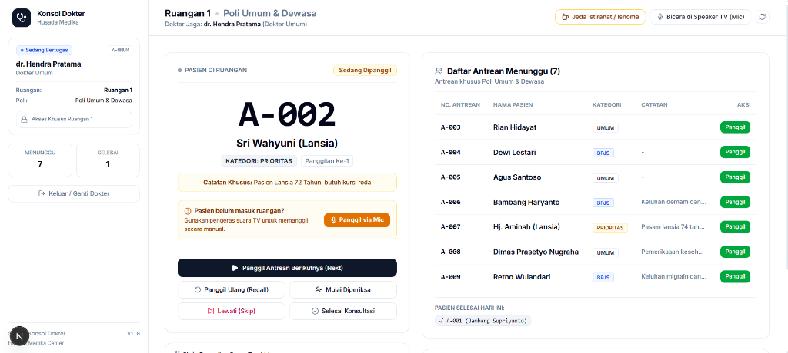

<div align="center">

# 🏥 Clinic Queue Management System
### *Modern Polyclinic Audio Queue Calling & Real-Time TV Display System*

[](https://nextjs.org/)
[](https://react.dev/)
[](https://laravel.com/)
[](https://www.php.net/)
[](https://tailwindcss.com/)
[](https://www.typescriptlang.org/)
[](https://ui.shadcn.com/)
[](LICENSE)

<br/>

[](https://github.com/topics/typescript)
[](https://github.com/topics/nextjs)
[](https://github.com/topics/laravel)
[](https://github.com/topics/queue-management)
[](https://github.com/topics/tailwind)
[](https://github.com/topics/hospital-system)
[](https://github.com/topics/shadcn-ui)
[](https://github.com/topics/webrtc)
[](https://github.com/topics/speech-synthesis)
[](https://github.com/topics/healthcare)

<br/>

*An integrated clinic and hospital queue management platform featuring automated phonetic voice announcements (Indonesian TTS), live microphone broadcast via WebRTC, and a soothing shadcn Smooth Blue interface.*

---

</div>

## 📸 Screenshots

### 1. Waiting Room Public TV Display (`/`)
*Real-time public display for clinic waiting areas featuring large active queue ticket typography, 5-room queue status overview, automatic cyclical room rotation, and announcement running text.*



### 2. Doctor Examination Console (`/console`)
*Room-isolated examination workspace for practitioners with queue calling controls (Next / Recall), consultation lifecycle tracking, patient skip, live WebRTC microphone intercom to TV speakers, and Ishoma break toggle.*



---

## 📌 System Overview

**Clinic Queue Management System** is a modern healthcare queue automation platform engineered for medical facilities, primary care clinics, and specialized hospitals. It modernizes traditional clinic queue operations through high-fidelity phonetic voice synthesis, direct browser-to-TV microphone intercom, and strict Role-Based Workspace Isolation.

The platform provides 4 specialized portals:
1. **Public TV Display (`/`)**: High-contrast waiting room monitor displaying the actively called patient, multi-room status rotation, and announcement ticker.
2. **Doctor Console (`/console`)**: Dedicated medical staff console isolated per room. Physicians can call next patients, recall missing visitors, start/complete consultations, and speak directly through TV speakers via WebRTC with a 30-second safety countdown.
3. **Self-Service Kiosk (`/kiosk`)**: Patient ticketing terminal for autonomous registration across clinics and coverage categories (General, BPJS, and Priority).
4. **Admin Workspace (`/admin`)**: Centralized management dashboard for doctor rooms, polyclinic master records, live queue tracking, and TV display customization.

---

## ✨ Key Features

- **🎙️ Dual Audio Engine (Phonetic TTS + WebRTC Intercom):**
  - Indonesian voice synthesis with dual synthesized chime presets (Standard Bell & Urgent Dingdong).
  - Phonetic normalization for medical acronyms and abbreviations (e.g., "Poli Gigi & Mulut", "Poli Spesialis Jantung").
  - Live doctor microphone streaming to waiting room TV speakers over WebRTC with automatic timeout (30 seconds) and audio collision prevention.
- **🔒 Room-Level Access Isolation:**
  - Medical staff are strictly constrained to their designated room and assigned polyclinic queues.
  - Public portals (TV display and kiosk) are sanitized of administrative and physician control links.
- **☕ Service Pause & Ishoma (Prayer/Break) Mode:**
  - One-click break mode for practitioners with animated pause banners on TV displays and kiosk notices informing incoming patients of prayer and rest intervals.
- **🎨 Soothing shadcn Smooth Blue Design System:**
  - Clinical azure palette (`oklch(0.52 0.17 250)`) designed for high visual comfort in healthcare environments without harsh glare.
  - Crisp Google Font Inter typography optimized for long-distance legibility on waiting room displays.
- **⚡ High-Performance Architecture:**
  - Fast client/server rendering powered by Next.js 16 (Turbopack, App Router).
  - Robust Laravel 13 REST API backend backed by 100% automated test coverage.

---

## 🏗️ Technical Architecture

| Component | Technology | Description |
| :--- | :--- | :--- |
| **Frontend Framework** | [Next.js 16.4.3](https://nextjs.org/) (React 19.3, TypeScript 5.9) | App Router architecture with Turbopack |
| **Styling & Icons** | [Tailwind CSS v4.3](https://tailwindcss.com/) & Lucide React | Soothing shadcn Smooth Blue design system (`oklch(0.52 0.17 250)`) |
| **Backend REST API** | [Laravel 13.38](https://laravel.com/) (PHP 8.3+) | Clean service-layer REST endpoints and seeders |
| **Database** | MySQL 8.0 / SQLite 3 | Relational schema with transactional queue integrity |
| **Audio Engine** | Web Speech Synthesis & Web Audio API | Client-side phonetic Indonesian TTS & algorithmic chime synthesis |
| **Live Intercom** | WebRTC DataChannel & MediaStream | Zero-latency browser-to-browser audio broadcast |
| **Test Suite** | PHPUnit 12.5 | 21 comprehensive feature tests (133 assertions) |

---

## 🚀 Installation & Getting Started

### Prerequisites
- **PHP** >= 8.3 & Composer
- **Node.js** >= 20.x (Recommended: v22 / v24) & npm
- **MySQL** >= 8.0 (or SQLite 3)

### 1. Clone the Repository
```bash
git clone https://github.com/pranataa-labs/Clinic-Queue-Management-System.git
cd Clinic-Queue-Management-System
```

### 2. Configure Backend (Laravel 13)
```bash
cd backend
composer install
cp .env.example .env
php artisan key:generate

# Configure your database credentials in .env, then migrate & seed:
php artisan migrate:fresh --seed
php artisan serve --port=8000
```
*Backend API will run at `http://localhost:8000`.*

### 3. Configure Frontend (Next.js 16)
Open a new terminal window in the project root:
```bash
cd frontend
npm install
npm run dev -- -p 3000
```
*Frontend application will run at `http://localhost:3000`.*

---

## 🖥️ Portal Navigation & Endpoints

| Endpoint URL | Portal Name | Target Audience / Device |
| :--- | :--- | :--- |
| `http://localhost:3000/` | **Waiting Room TV Display** | Public Waiting Hall (Wall-Mounted Smart TV) |
| `http://localhost:3000/console` | **Doctor Examination Console** | Physician Desks & Examination Rooms |
| `http://localhost:3000/kiosk` | **Self-Service Ticketing Kiosk** | Clinic Entrance / Reception Kiosk |
| `http://localhost:3000/admin` | **Central Admin Dashboard** | Clinic Administrators & IT Operators |

---

## 🧪 Automated Testing

Execute the backend test suite to verify queue dispatching, transaction safety, and edge cases:
```bash
cd backend
php artisan test
```

Execute static typing and Next.js production build verification:
```bash
cd frontend
npm run build
```

---

## 📄 License

This project is licensed under the [MIT License](LICENSE).

<div align="center">
  <sub>Engineered with dedication by <a href="https://github.com/pranataa-labs">Pranataa Labs</a></sub>
</div>
